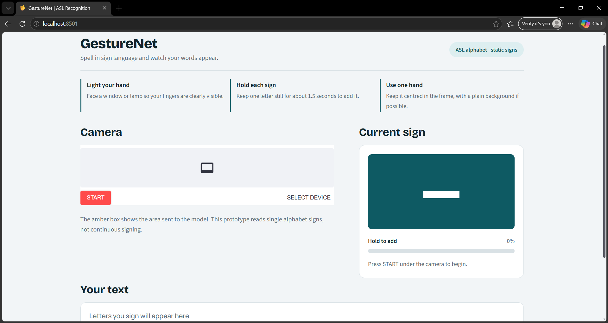
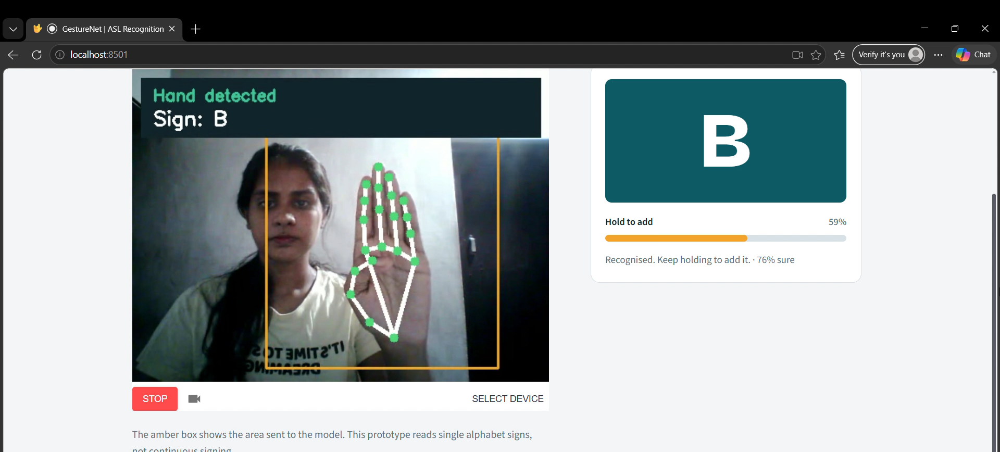

# GestureNet
## Real-Time ASL Recognition Using Deep Learning

### Project Title
GestureNet: Real-Time American Sign Language (ASL) Recognition Using Deep Learning

### Abstract
GestureNet is a deep learning-based application designed to recognize American Sign Language (ASL) gestures in real time. The project aims to help bridge communication gaps by identifying hand gestures through a camera and converting them into recognizable letters or text.

### Student and Guide
- **Student Name:** Anugraha Das
- **Guide Name:** [Enter your tutor's name]

### Tech Stack
- Python
- Streamlit
- TensorFlow / Keras
- OpenCV
- MediaPipe
- NumPy
- Streamlit-WebRTC

### Setup Instructions
1. Clone or download the project repository.
2. Create and activate a Python virtual environment.
3. Install the required dependencies using `pip install -r requirements.txt`.
4. Ensure the trained model is available at `model/best_mobilenetv2_asl.keras`.
5. Run the application using `streamlit run app.py`.

## Screenshots / Demo

### GestureNet Demo

### GestureNet Demo 2

### Problem Statement
Communication between ASL users and people unfamiliar with sign language can be challenging. GestureNet aims to explore real-time gesture recognition using computer vision and deep learning to support more accessible communication.

### Outcome
The project aims to recognize ASL gestures in real time using a trained deep learning model and present the predictions through a Streamlit web interface.
